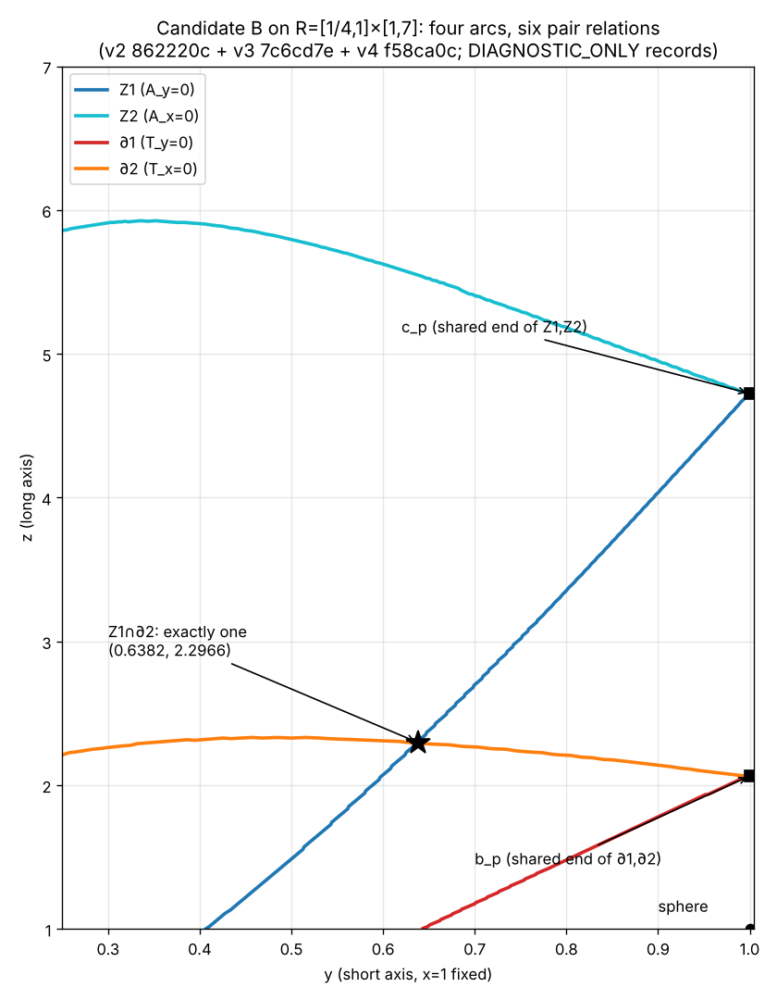

# 実例1：三軸楕円体の四本の零曲線 — 「はかり方」を変えて閉じた記録

2026-11-27 JST · chat（Claude）起草 · Judge 指示「候補 B の v1→v4 の経過を有効性の実例として使う」

**同じ計算核（3 ファイル、v1〜v4 でバイト単位に同一）のまま、はかり方と進め方だけを 3 回変えて、未完の結果が完全な結果になった。** 計算量は増やしていない。最後の 2 版は合計 3 分で終わった。

## 問題

角度エネルギー（[論文 I](https://doi.org/10.5281/zenodo.24495446)）を三軸楕円体 diag(1, y, z) に置く。形の範囲 R=[1/4,1]×[1,7] で、中心 Hessian の零曲線 Z₁, Z₂ と、極点トレースの零曲線 ∂₁, ∂₂ の配置を確定する。四つの量はどれも球面上の積分で、閉じた式はない。

**結果（Judge 採用 [2d2576e](https://github.com/cotaxxxx/bg-triaxial-family/commit/2d2576ee43f07a3cb94df28d63051f52649e3c81)）**：四本はそれぞれ 1 本の弧。Z₁–Z₂ は端点 c_p のみ共有、∂₁–∂₂ は端点 b_p のみ共有、Z₁–∂₁・Z₂–∂₁・Z₂–∂₂ は交わらず、Z₁–∂₂ は内部でちょうど 1 点（y*∈[0.63813110, 0.63821937]、z*∈[2.29643023, 2.29674050]）で横断的に交わる。

## 有効性の記録

| 版 | 変えたもの（計算核は不変） | セル評価 | 時間 | 符号が決まった面積 | 未決の箱 | 弧として連結 | 六組の関係 |
|---|---|---:|---:|---|---:|---|---|
| v1 | — | 4,000,000 | 9 分 5 秒 | 1.5〜16.8% | 多数（行順で打ち切り） | 0/4 | 0/6 |
| v2 | **進め方**：主項を先に測る／角度を先に細かく／境界根から曲線を追う／予算の釣り合い | 93,135,344 | 4 時間 5 分 | 99.2〜99.8% | 8,674 | 4/4 | 1/6 |
| v3 | **はかり方**：共有端点で差から (1−y) を外す／既存の帯を横に広げて微分 1 回でまとめて覆う | 393,344 | 2 分 56 秒 | — | **0** | 4/4（被覆完了） | 5/6 |
| v4 | **向き**：Z₁ は左右の面、∂₂ は上下の面で読む（Miranda＋傾きの積）。新規評価は Krawczyk の補強のみ | 8,160 | 4.5 秒 | — | 0 | 4/4 | **6/6** |

読み取れること：

1. **v1→v2：測る順序。** 核は同じ。形の箱を割る前に角度の積分を細かくし、根のある境界から曲線を追うだけで、覆えた面積が 2〜17% から 99% 超になった。
2. **v2→v3：細分では解けない場所は、量を作り直す。** v2 の未決 2,067 箱は 1 か所（共有端点 b_p）に集中していた（[図](v2_open_boxes_map.png)）。y=1 で T_y≡T_x となる対称性から、差を (1−y)·D と書き直すと D が厳密符号を持ち、二本の曲線が分離できた。残りの 6,607 箱は、既存の帯を横に広げた長方形 242 本に収まり、**長方形 1 本につき微分 1 回**で済んだ。v2 が 5 時間かけて残した箱を、v3 は 3 分で全部覆った。
3. **v3→v4：帯の向きを曲線に合わせる。** v3 は両方の曲線を z=z(y) のグラフとして扱い、ほぼ縦に走る Z₁ で面の符号が取れなかった。向きを直すと、**主証明は既存の台帳だけで成立した**（新規の評価なし。傾きの積の上界 0.7105<1）。Krawczyk 法は幅 1/1024 の箱で縮小率 0.067 で成立し、補強になった。

## 3 点セット

| | 内容 | 固定版 |
|---|---|---|
| **検証方法** | 計画と導出。各版とも実行前に固定 | v1 計画 [f8c809f](https://github.com/cotaxxxx/bg-triaxial-family/tree/f8c809f2e2cfdc32da04aba120e7e8fd1001de7e/evidence/astra/2026-11-26/CANDIDATE_B_PLAN)・束 [f70b83b](https://github.com/cotaxxxx/bg-triaxial-family/tree/f70b83b24fc62b7bbd7b3d70b24163ab8bf8f779/evidence/astra/2026-11-26/CANDIDATE_B_BUNDLE)、v2 [bb50c85](https://github.com/cotaxxxx/bg-triaxial-family/tree/bb50c85c1bff93e3e04b54c5cbd218dcb3768a96/evidence/astra/2026-11-26/CANDIDATE_B_V2)、v3 [cdd885b](https://github.com/cotaxxxx/bg-triaxial-family/tree/cdd885b5ff0fa31408f08a97c382f230f24bab04/evidence/astra/2026-11-26/CANDIDATE_B_V3)、v4 [e7c039e](https://github.com/cotaxxxx/bg-triaxial-family/tree/e7c039ee315162a9d3e001734128023bba3ac00f/evidence/astra/2026-11-27/CANDIDATE_B_V4) |
| **検証結果** | 研究PCの台帳一式（符号箱、帯、辺根、接続、交差）と独立監査 | v1 e5456d8、v2 [862220c](https://github.com/cotaxxxx/bg-triaxial-family/tree/862220cc03f8044ab770548d865a76ed56fc612c/evidence/dig/2026-11-26/CANDIDATE_B_V2_PC_RESULT)、v3 [7c6cd7e](https://github.com/cotaxxxx/bg-triaxial-family/tree/7c6cd7ecb21d7d4465e2140c5465412e4f3a4720/evidence/dig/2026-11-27/CANDIDATE_B_V3_PC_RESULT)、v4 [f58ca0c](https://github.com/cotaxxxx/bg-triaxial-family/tree/f58ca0c871bc075c89f09aa1df5a2e4ec4b702b7/evidence/dig/2026-11-27/CANDIDATE_B_V4_PC_RESULT)。監査：e38c01c、70313ef、c1f465b、5c27aa7、[fa71d4c](https://github.com/cotaxxxx/bg-triaxial-family/blob/fa71d4c/evidence/chat/2026-11-27/CHAT_AUDIT_CANDIDATE_B_V4_RESULT_f58ca0c.md) |
| **再現コード** | MPFR 核（`src/candidate.c`, `interval.h`, `jets.h`）、各版の実行コード、生産者コードを読み込まない検査器、SHA-256 | 上の各束。監査側の独立スクリプトは bg-triaxial-family `evidence/chat/2026-11-26/chat_checks/`・`2026-11-27/chat_checks/` |

## 正直な限界

- **対照実験ではない。** 同じ問題を「GeoEnclosure なし」で同じ条件で解いた比較はない。v1 自体も GeoEnclosure の枠内の最初の試みで、比較は「同じ核・同じ機械での進め方とはかり方の違い」である。
- 使った道具（区間演算、帯による陰関数曲線の追跡、Poincaré–Miranda、Krawczyk）はどれも既存。寄与は、どの量をどの向きで測るかを幾何の構造から決めた過程にある。
- 範囲は R のみ。原記録の等級は DIAGNOSTIC_ONLY で、採用は Judge 裁定による。零曲線の確定は、停留点の生成・消滅そのものの証明ではない。
- 前提：MPFR 4.2.2 の丸め保証、候補 B v1 の導出。

## 役割

Judge（古田勝士）がすべての判断。ChatGPT Work（Astra・Codex）が計画・導出・コード。ChatGPT（Dig）が研究PCの実行と登録。Claude（chat）が各版の束と結果の監査、未決箱の診断（v2→v3、v3→v4 の提案）、本文書の起草。
